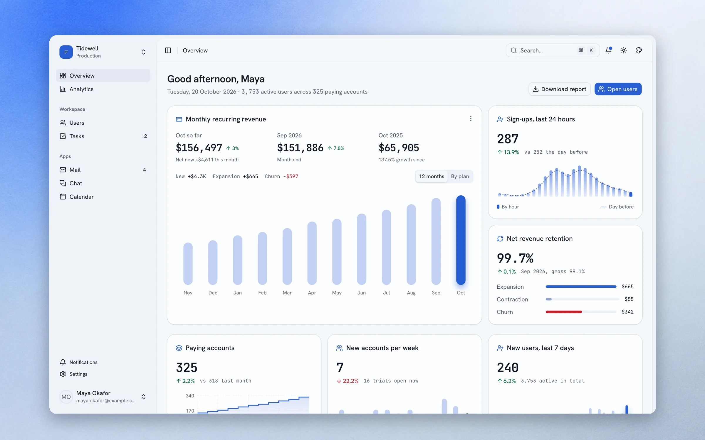
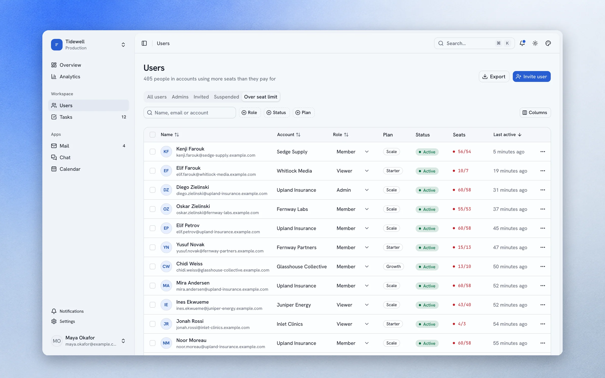

# Chronicle: free shadcn admin dashboard template

**Chronicle is a free, MIT-licensed admin dashboard template for Next.js, built with shadcn/ui on Base UI, Tailwind CSS v4 and the ShadcnStore Dashboard Kit.** Clone it, install, run it, and you have an admin panel with real screens, real interactions and sample data where every number adds up.

[**Live demo**](https://demo.shadcnstore.com/chronicle/) · [Template page](https://shadcnstore.com/templates/dashboards/chronicle) · [Changelog](./CHANGELOG.md) · [Docs](./docs/README.md)

If Chronicle saves you a week, a star helps other developers find it.



## Get started

```bash
git clone https://github.com/shadcnstore/shadcn-dashboard-landing-template.git chronicle
cd chronicle
pnpm install
pnpm dev
```

Open http://localhost:3000. No environment variables, no API keys, no database: the sample data is generated in the browser from a fixed seed. Node.js 20.19 or newer.

## What you get

| | |
|---|---|
| **Stack** | Next.js 16 (App Router), React 19, TypeScript, Tailwind CSS v4, shadcn/ui (`base-nova` style on Base UI, no Radix), TanStack Query and Table, Recharts, nuqs, zustand |
| **Screens** | 31 pages: Overview, Analytics, Users (list and detail), Tasks (board and table), Mail, Chat, Calendar, Notifications, Pricing, FAQs, Settings (profile, account, appearance, notifications, connections), sign-in, sign-up and forgot password in three layouts each, five error pages, and a full SaaS landing page |
| **Signature screen** | Users: saved views, faceted filters and search kept in the address bar, sort, column menu, inline role editing, bulk actions with undo, CSV export, a record sheet |
| **Theme** | Slate and cobalt, light and dark, plus eight more presets that restyle every surface. A customizer changes preset, radius, font, scale, sidebar style, layout (sidebar or top nav) and direction (LTR or RTL) live |
| **Data** | One fictional company, named Chronicle like the template, generated from a seed and pinned to 20 October 2026, so the dashboard looks the same every day. Tests prove the totals equal the sum of their rows |
| **Backend-ready** | Every screen reads and writes through one data adapter (`lib/data.ts`). Swap the in-memory adapter for your API and the screens keep working: [docs/connect-your-backend.md](./docs/connect-your-backend.md) |
| **Keyboard** | ⌘K search and actions, `G` then a letter to jump between pages, `?` for every shortcut, `D` for dark mode |
| **Licence** | MIT, including commercial use |



## Free and paid

Chronicle is the free member of a family of dashboard templates built on the same Dashboard Kit. The `kit/` folder here is a vendored copy of that Kit, MIT in this repository.

| | Chronicle (free) | Paid templates |
|---|:---:|:---:|
| Shell, customizer, ⌘K, shortcuts, notifications | ✓ | ✓ |
| Data adapter, data table, saved views, chart widgets | ✓ | ✓ |
| A complete business with its own screens and dataset | | ✓ |
| An assistant that proposes changes for your approval | | ✓ |
| Team and roles, billing and plans, API keys | | ✓ |
| Licence | MIT | Commercial |

[Emporium](https://shadcnstore.com/templates/dashboards/emporium) is an e-commerce admin built on the same Kit. [Pro](https://shadcnstore.com/pricing) includes every template and premium block on ShadcnStore.

## Project structure

```text
app/                 Routes: (shell) for the dashboard, (auth), errors, landing
features/<screen>/   Each screen's components and logic
kit/                 The Dashboard Kit (vendored, do not edit: see docs/kit.md)
components/ui/       shadcn/ui components, exactly as the CLI installs them
config/brand.ts      Name, mark, tagline and the ShadcnStore credits: rebrand here
config/              Navigation, site, theme and settings menus
data/                The Chronicle sample data generator and its tests
lib/data.ts          The data adapter every screen uses
lib/clock.ts         The pinned "now" the sample data is built from
docs/                Guides
```

## Common questions

**Is Chronicle free for commercial use?** Yes. It is MIT licensed: use it in client work and commercial products, no attribution required.

**Does it use Radix UI?** No. Every component is shadcn/ui on Base UI (`base-nova`). Compose with the `render` prop, not `asChild`.

**Is there a Vite version?** Version 2 (tag [`v2.0.0`](https://github.com/shadcnstore/shadcn-dashboard-landing-template/tree/v2.0.0)) has both Vite and Next.js and stays available. A Vite edition of version 3 is planned next, on the same screens; until it ships, version 2 is the Vite option.

**How do I connect my own API?** Replace the in-memory adapter in `lib/data.ts` with an object that has six methods (`list`, `get`, `create`, `update`, `remove`, `action`). See [docs/connect-your-backend.md](./docs/connect-your-backend.md).

**How do I change the colours?** Edit the `:root` and `.dark` blocks in `app/globals.css`, or pick a preset in the customizer and copy its CSS. See [docs/theming.md](./docs/theming.md).

**Why does the data never change?** The demo clock is pinned (`lib/clock.ts`) so screenshots and charts are stable. Set `DEMO_NOW` to `null` to use the real time.

**Where is the landing page?** At `/landing`: the Frontier SaaS landing page, sharing the dashboard's theme.

## Scripts

| Command | What it does |
|---|---|
| `pnpm dev` | Development server |
| `pnpm build` / `pnpm start` | Production build and server |
| `pnpm lint` / `pnpm typecheck` / `pnpm test` | ESLint, TypeScript, Vitest (theme contract and data reconciliation) |
| `STATIC_EXPORT=1 pnpm build` | Static site in `out/` ([docs/deploying.md](./docs/deploying.md)) |
| `pnpm build:demo` | The public demo: a static export with the demo extras |

## Contributing

Issues and pull requests are welcome. Run `pnpm lint && pnpm typecheck && pnpm test` before opening a pull request. Changes to `kit/` belong upstream in the Dashboard Kit, so open an issue describing them instead.

## Licence

[MIT](./LICENSE) © ShadcnStore. Made by [ShadcnStore](https://shadcnstore.com).
